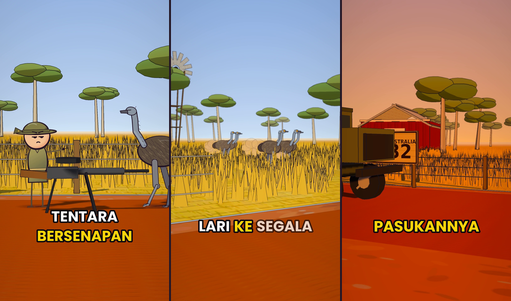
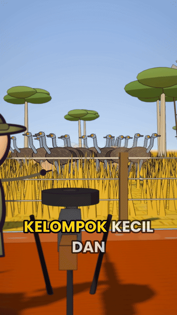

# cartoon-short



Make a vertical animated cartoon short: idea → script → voiceover → finished MP4.

Flat 2D bean-head cartoon characters (canvas-drawn cards with plum outlines) in a colourful 3D world with black ink outlines, painted textures, depth-of-field and gliding cameras. The output is **1080×1920, 30 fps, exactly as long as the voiceover**. The voice is never edited or re-timed — the picture is timed to it, and every visual reaction lands 0–3 frames before its word.

Music and SFX are synthesized and sit at **50% of the voice level** (−6 dB). Proven on "The Soldier Who Never Left" (19.7 s, 8 shots) and the Emu War short (38 s, 1153 frames).

## What you get

- **10 video ideas** from one topic: title, hook line, twist, why it animates well, and whether it is true history or legend.
- **A script** built on a hook → setting → escalation → pivot → twist formula, sized at ~3.7 words per second (20 s ≈ 75 words, 30 s ≈ 110, 60 s ≈ 220).
- **Exact timing** from your voiceover + script — no speech recognition needed. Word timestamps come from silence alignment (or Whisper, if installed).
- **A shot plan, a 3D world, a cast, motion, and sound** — then a frame-by-frame render, a frame QA check, and a finished MP4 with loudness normalized to about −14 LUFS.
- **Animated word-by-word captions** (spoken word in yellow), burned in only if you want them.
- **A publishing pack**: thumbnail, 4:5 cover, and a platform-checked caption file.

**v4.0** adds parallel rendering, label auto-fit, check.py config, `bootstrap.sh` and `export.sh` (see CHANGELOG.md).

## Requirements

- Node.js 22.6+
- Python 3 with numpy + Pillow
- ffmpeg
- Playwright with Chromium (`npm i -g playwright && npx playwright install chromium`)

`setup.sh` fetches three.js r160 itself (npm first, sparse git clone as fallback). The Pen library (`toon.ts`) ships in `kit/vendor/`.

## Quick start

```bash
# 0. (fresh machine) check tools and find Chrome
bash bootstrap.sh && source .env.cartoon

# 1. Set up a project from the kit
bash kit/tools/setup.sh ~/shorts/my-short

# 2. Time the voiceover against the script
cd ~/shorts/my-short
python3 timing.py voice.mp3 script.txt --out work

# 3. Plan the shots, then build the world, cast, motion and sound
#    (see work/PLAN.md, web/story.js, web/roman.js, audio.py)

# 4. Check the look before the long render
node render.mjs stills/a "5,40,..."
python3 sheet.py stills/a stills/sheet_a.jpg
bash preview.sh   # half-res preview with mixed audio

# 5. Render, check, finish
node render.mjs frames "0-1059"
python3 check.py frames
CAPTIONS=work/words.json bash finish.sh "My Short Title"

# 6. Or finish + publishing pack in one go (TITLE/POST_TITLE/DESC/TAGS/HOOK env, VARIANTS=1 for 1:1 and 16:9)
#    bash export.sh "My Short Title"
#    Publishing pack alone:
python3 publish.py --frames frames --frame 60 --title "SHORT TITLE" \
  --post-title "Full post title" --desc "Caption text" --tags "#a #b"
```

`RESUME=1 node render.mjs frames ...` continues after an interruption. Renders run at about 3–10 s per frame on CPU (SwiftShader); use `CHROME_PATH=/usr/bin/google-chrome` if you have a system Chrome.

## Project layout

```
SKILL.md         # the full skill: ideas, script formula, build stages, gotchas
kit/
  engine/        # three.js world, toon materials, ink pass, DOF, render targets
  tools/         # setup.sh, timing.py, render.mjs, audio.py, mix.py,
                 # check.py, captions.py, finish.sh, preview.sh, publish.py, sheet.py
  library/       # reusable prop builders (signs, houses, vehicles, trees, ...)
  example/
    soldier/     # "The Soldier Who Never Left" — first worked example
    emu-war/     # Emu War short — second worked example (1153 frames)
    wiretap/     # LIMS vs Spyware — third example (night city, labels, checks.json)
  vendor/        # toon.ts Pen library (MIT, see kit/vendor/NOTICE.md)
assets/
  banner.png     # header image: three frames from the Emu War example
  demo.gif       # short motion demo: emus running through the wheat
```

## Rules the skill follows

- Stories, characters and shots are always original. Never recreate another creator's video shot for shot.
- No real, named living people as characters, and no brand mascots or logos.
- Captions are offered at the end and burned in only if wanted. Diegetic text (signs, carved messages) must read correctly, never mirrored.
- Audio levels are locked by `mix.py`: music at 50% of the voice (−6 dB gated RMS), SFX at 50% or less with peaks capped at 0.7× the voice peak. No ducking or compression that changes the ratio.
- A stills contact sheet (or preview) is always checked before the long render.

## Examples

- **The Soldier Who Never Left** — 19.7 s, 8 shots. The original proof that the pipeline works.
- **Emu War** — 38 s, 1153 frames. Australia, 1932: the army, two machine guns, 10,000 rounds — and the emus won. Indonesian voiceover, Australian outfits, truck, props and a full audio cue table included in `kit/example/emu-war/`.



## Credits

Built on the [claude-animated-shorts](https://github.com/mromidev/claude-animated-shorts) engine and Pen library (`toon.ts`), and three.js r160 — both MIT licensed. See `kit/vendor/NOTICE.md`. Everything else in this repo (the skill text, tools, prop library and examples) is original work, also released under the MIT License.

## License

MIT. See `LICENSE`.
